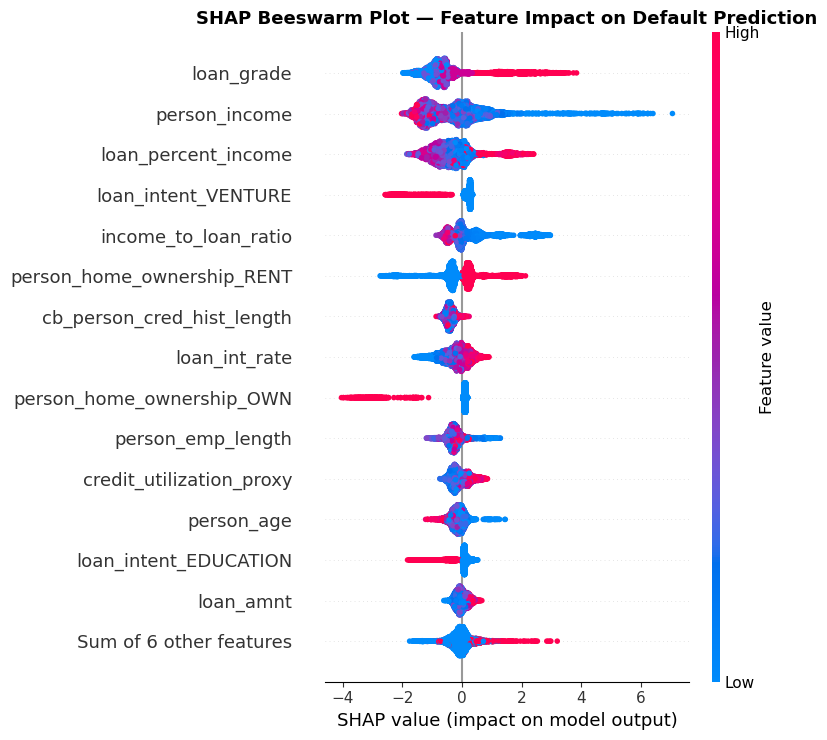
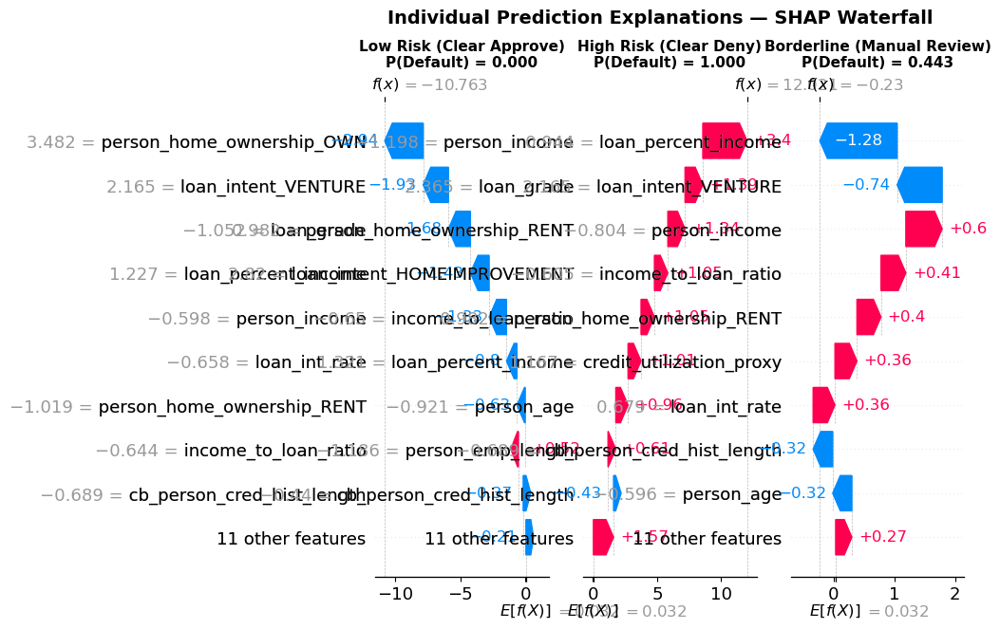
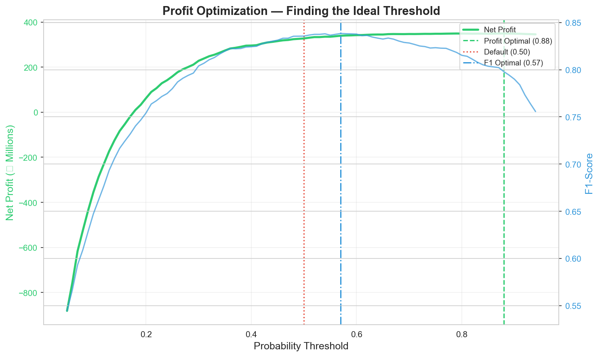
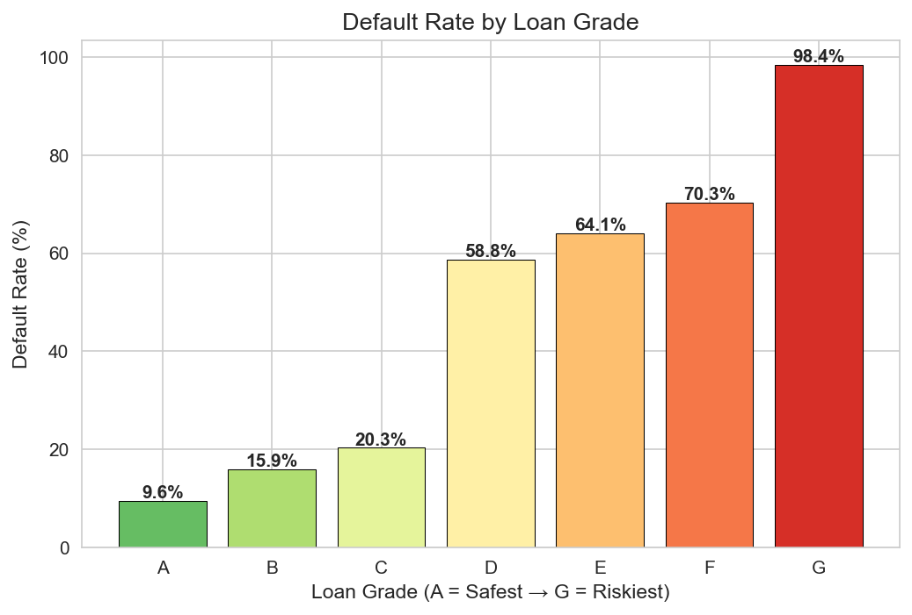
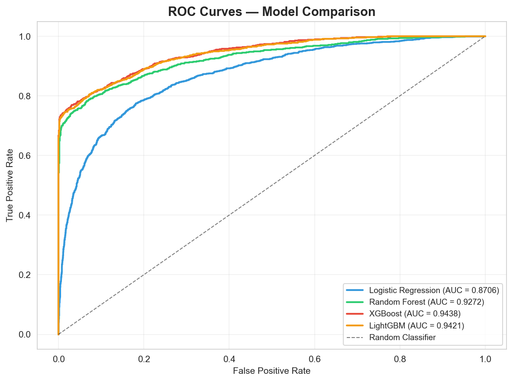
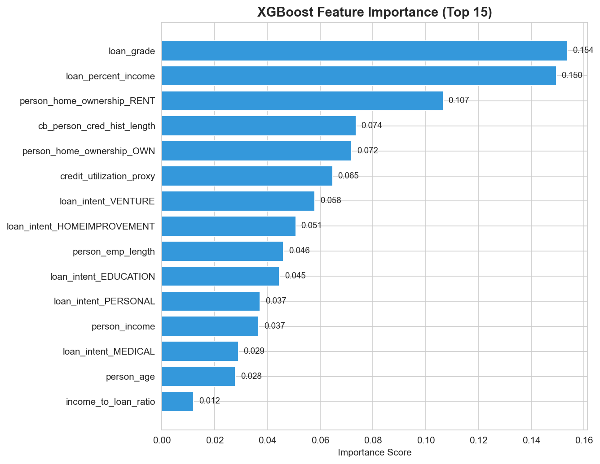

# 🏦 Credit Risk Modeling & Profit Optimization

[](https://www.python.org/downloads/)
[](https://opensource.org/licenses/MIT)
[](https://xgboost.readthedocs.io/)
[](https://shap.readthedocs.io/)

A production-grade **Credit Risk Underwriting and Loan Default Prediction** system engineered to go beyond traditional classification accuracy. Built to mirror actual commercial banking constraints, this project incorporates **RBI-mandated adverse action explainability (via SHAP reason codes)** and **profit-maximizing threshold optimization (using a custom banking cost matrix)**.

---

## 📌 Key Architectural Pillars

```
       ┌────────────────────────────────────────────────────────┐
       │   Kaggle Credit Bureau Dataset (32,581 Loan Records)   │
       └──────────────────────────┬─────────────────────────────┘
                                  ▼
       ┌────────────────────────────────────────────────────────┐
       │ Preprocessing, Outlier Removal, & Imputation Pipeline   │
       └──────────────────────────┬─────────────────────────────┘
                                  ▼
       ┌────────────────────────────────────────────────────────┐
       │ Feature Engineering & SMOTE Class Imbalance Handling   │
       │   - income_to_loan_ratio, credit_utilization_proxy     │
       └──────────────────────────┬─────────────────────────────┘
                                  ▼
       ┌────────────────────────────────────────────────────────┐
       │ Multi-Model Benchmarking & Optuna Bayesian Tuning      │
       │   - LogReg, Random Forest, LightGBM, Tuned XGBoost     │
       └──────────────┬──────────────────────────┬──────────────┘
                      │                          │
                      ▼                          ▼
       ┌────────────────────────┐      ┌────────────────────────┐
       │   SHAP Explainability  │      │   Profit Optimization  │
       │   (RBI Reason Codes)   │      │  (Asymmetric Matrix)   │
       │ - Local & Global SHAP  │      │ - FP Loss: ₹5,00,000   │
       │ - Adverse Action Code  │      │ - FN Loss: ₹50,000     │
       │ - Top 3 Reasons/Denial │      │ - Optimal Thresh: 0.88 │
       └────────────────────────┘      └────────────────────────┘
```

---

## 🏆 Key Performance Metrics

Evaluated on an out-of-sample stratified holdout test set of **6,330 loans** (21.6% true default prevalence).

| Model Architecture | Accuracy | Precision | Recall | F1-Score | ROC-AUC | PR-AUC |
| :--- | :---: | :---: | :---: | :---: | :---: | :---: |
| **Logistic Regression** | 79.59% | 51.76% | 78.75% | 0.6246 | 0.8706 | 0.7068 |
| **Random Forest** | 91.50% | 83.70% | 75.24% | 0.7924 | 0.9272 | 0.8756 |
| **LightGBM** | 93.59% | 96.15% | 73.19% | 0.8311 | 0.9421 | 0.8927 |
| **XGBoost (Baseline)** | 93.81% | 97.00% | 73.55% | 0.8367 | 0.9438 | 0.8953 |
| **XGBoost (Optuna Tuned)** 🏆 | **93.70%** | **95.48%** | **74.29%** | **0.8356** | **0.9466** | **0.8991** |

---

## 🔍 1. Model Explainability & Adverse Action (The RBI Requirement)

In modern regulated banking (RBI in India, CFPB in the US), credit decisions cannot rely on black-box predictions. Underwriters must legally supply actionable **adverse action reason codes** whenever credit is denied.

### Implementation:
- Integrated **TreeExplainer SHAP** to extract individual feature attributions for every rejected loan.
- Generated top 3 adverse reason codes indicating exactly which factors increased default probability.
- Full compliance dataset generated at `reports/denial_reason_codes.csv` (1,062 denied applications).

```text
Sample Denial Reason Notice:
Applicant ID #22426 | Default Risk Score: 91.4 / 100
- Reason 1: Subprime Loan Grade Tier D/E/F/G (+0.81 log-odds risk)
- Reason 2: Low Annual Income Relative to Requested Capital (+0.64 log-odds risk)
- Reason 3: Elevated Debt-to-Income / Loan Percent of Income
Recommendation: Formal Rejection with Adverse Action Letter
```


*Global SHAP feature impact distribution across all test applicants.*


*Local SHAP waterfall explanations across Approval, Borderline, and Rejection profiles.*

---

## 💰 2. Profit Optimization (Cost Matrix vs. F1-Score)

In lending, errors have asymmetric financial consequences:
- **False Positive (Type I)**: Granting loan to a defaulter $\rightarrow$ Bank loses entire principal (**-₹5,00,000**).
- **False Negative (Type II)**: Rejecting a good applicant $\rightarrow$ Bank loses interest margin (**-₹50,000**).
- **Cost Ratio**: False Positives are **10x more costly** than False Negatives.

### Optimal Operating Point:
Standard machine learning models operate at threshold $t = 0.50$, prioritizing F1-score over capital preservation. By sweeping thresholds against the banking cost matrix:

| Operating Threshold | Net Portfolio Profit | Approved Default Rate | Description |
| :---: | :---: | :---: | :--- |
| **0.50 (Default)** | ₹32,72,25,000 | 0.97% | Standard statistical cutoff |
| **0.57 (Max F1)** | ₹33,93,75,000 | 0.81% | Balances Precision & Recall |
| **0.88 (Profit Optimal)** 🏆 | **₹34,94,25,000** | **0.00%** | **+₹2.22 Crore (+6.8%) Net Profit Gain** |



### Underwriter Decision Routing:
Applicants are segmented into operational workflow tiers:
- **Auto-Approve ($P < 0.68$)**: 84.4% of applicants cleared via straight-through processing.
- **Manual Review ($0.68 \le P < 0.90$)**: 1.5% routed to senior underwriters for secondary documentation.
- **Auto-Reject ($P \ge 0.90$)**: 14.1% rejected with automated RBI reason codes.

---

## 📈 3. Exploratory Data Analysis Highlights

- **Loan Grade Predictive Power**: Default rates rise monotonically from 9.6% (Grade A) to 98.4% (Grade G).
- **Debt Burden**: Defaulters exhibit significantly higher `loan_percent_income` (median 0.26 vs. 0.13).
- **Prior Default Impact**: Applicants with prior default on file show more than 2x higher default probability (37.6% vs 18.1%).

| Default Rate by Grade | ROC Curves | Feature Importance |
| :---: | :---: | :---: |
|  |  |  |

---

## 📁 Repository Structure

```text
credit-risk-modeling/
├── data/
│   ├── raw/                            # Original Kaggle dataset
│   └── processed/                      # Cleaned features & train/test splits
├── notebooks/
│   ├── 01_data_loading_and_cleaning.py # Outlier removal & grade-based imputation
│   ├── 02_eda.py                       # 10 publication-grade EDA visualizations
│   ├── 03_feature_engineering.py       # Ratio creation, encoding & SMOTE balancing
│   ├── 04_model_training.py            # Model training & Optuna Bayesian tuning
│   ├── 05_shap_explainability.py       # SHAP TreeExplainer & reason codes
│   └── 06_profit_optimization.py       # Cost matrix & threshold optimization
├── src/
│   ├── data_preprocessing.py           # Core cleaning & schema validation
│   ├── feature_engineering.py          # Feature transforms & scalers
│   ├── model_training.py               # Benchmark trainer & Optuna search
│   ├── explainability.py               # SHAP wrapper & reason code generator
│   └── profit_optimizer.py             # Asymmetric cost matrix calculator
├── images/                             # 20 high-resolution analytical plots
├── models/
│   └── best_xgb_model.pkl              # Serialized production pipeline
├── reports/
│   ├── denial_reason_codes.csv         # 1,062 audited adverse action entries
│   ├── model_metrics.csv               # Complete cross-model benchmark
│   ├── profit_analysis.csv             # Full threshold sweep matrix
│   ├── model_comparison.md             # Detailed benchmark report
│   └── business_impact.md              # Financial & regulatory impact study
├── requirements.txt
└── README.md
```

---

## 🚀 Quickstart & Reproduction

```bash
# Clone the repository
git clone https://github.com/AyushChoudhary-X/credit-risk-modeling.git
cd credit-risk-modeling

# Install dependencies
pip install -r requirements.txt

# Execute end-to-end pipeline
python notebooks/01_data_loading_and_cleaning.py
python notebooks/02_eda.py
python notebooks/03_feature_engineering.py
python notebooks/04_model_training.py
python notebooks/05_shap_explainability.py
python notebooks/06_profit_optimization.py
```

---

## 📄 License
This project is licensed under the MIT License - see the LICENSE file for details.
